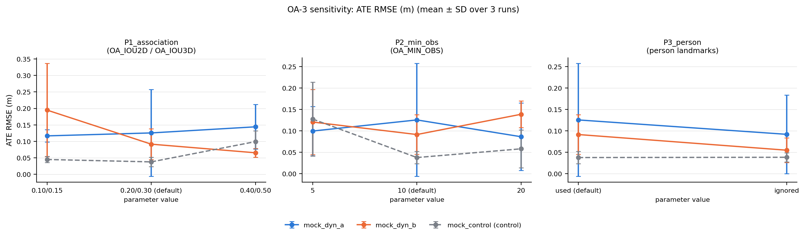
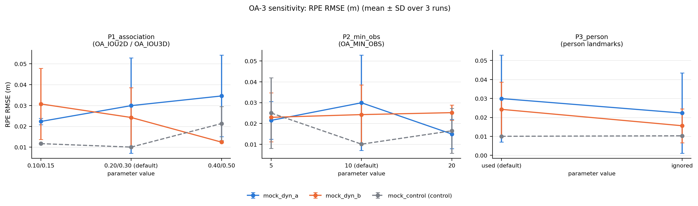
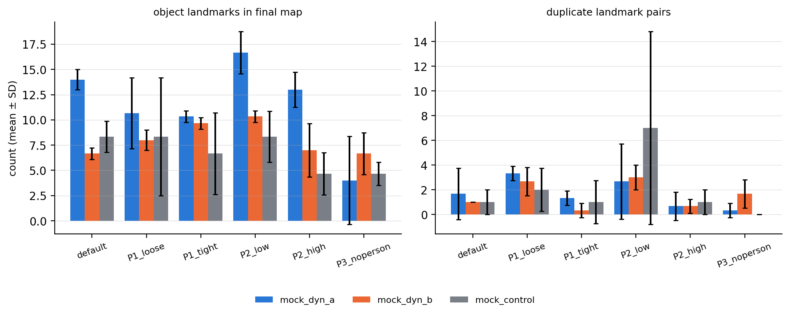

> CONTOH keluaran dari OA-SLAM TIRUAN (mock) — angkanya tidak bermakna; hanya menunjukkan bentuk laporan.

# OA-3 parameter-sensitivity (ablation) report — OA-SLAM-YOLOv8n

Generated 2026-09-28 14:09:08 from `/tmp/claude-0/-home-claude/bb469de6-a887-5d4c-a467-9975a2bebe65/scratchpad/oa3-agent/results_mock/oa3_results.csv`.

**Platform:** vm, x86_64, 2 CPU threads, Python 3.11.15

**Design:** one-factor-at-a-time around the default configuration; 3 repeated runs per cell; sequences `mock_dyn_a`, `mock_dyn_b`, `mock_control`; control sequence `mock_control` (tolerance ±25 %).

**Evaluation:** ATE RMSE after SE(3) Umeyama alignment; RPE RMSE over 1 frame(s); untracked frames dropped; backend evo/builtin as recorded per run.

## 1. Cells and effective parameters

| cell | variables passed | echoed by the executable (`EFFECTIVE`) | detection filter |
|---|---|---|---|
| `default` | OA_DET_SCORE=0.5, OA_IOU2D=0.2, OA_IOU3D=0.3, OA_TIME_DIFF=30, OA_NB_MATCH=10, OA_MIN_OBS=10, OA_MAP_OBS=40 | OA_DET_SCORE=0.5, OA_IOU2D=0.2, OA_IOU3D=0.3, OA_MAP_OBS=40, OA_MIN_OBS=10, OA_NB_MATCH=10, OA_TIME_DIFF=30 | – |
| `P1_loose` | OA_DET_SCORE=0.5, OA_IOU2D=0.1, OA_IOU3D=0.15, OA_TIME_DIFF=30, OA_NB_MATCH=10, OA_MIN_OBS=10, OA_MAP_OBS=40 | OA_DET_SCORE=0.5, OA_IOU2D=0.1, OA_IOU3D=0.15, OA_MAP_OBS=40, OA_MIN_OBS=10, OA_NB_MATCH=10, OA_TIME_DIFF=30 | – |
| `P1_tight` | OA_DET_SCORE=0.5, OA_IOU2D=0.4, OA_IOU3D=0.5, OA_TIME_DIFF=30, OA_NB_MATCH=10, OA_MIN_OBS=10, OA_MAP_OBS=40 | OA_DET_SCORE=0.5, OA_IOU2D=0.4, OA_IOU3D=0.5, OA_MAP_OBS=40, OA_MIN_OBS=10, OA_NB_MATCH=10, OA_TIME_DIFF=30 | – |
| `P2_low` | OA_DET_SCORE=0.5, OA_IOU2D=0.2, OA_IOU3D=0.3, OA_TIME_DIFF=30, OA_NB_MATCH=10, OA_MIN_OBS=5, OA_MAP_OBS=40 | OA_DET_SCORE=0.5, OA_IOU2D=0.2, OA_IOU3D=0.3, OA_MAP_OBS=40, OA_MIN_OBS=5, OA_NB_MATCH=10, OA_TIME_DIFF=30 | – |
| `P2_high` | OA_DET_SCORE=0.5, OA_IOU2D=0.2, OA_IOU3D=0.3, OA_TIME_DIFF=30, OA_NB_MATCH=10, OA_MIN_OBS=20, OA_MAP_OBS=40 | OA_DET_SCORE=0.5, OA_IOU2D=0.2, OA_IOU3D=0.3, OA_MAP_OBS=40, OA_MIN_OBS=20, OA_NB_MATCH=10, OA_TIME_DIFF=30 | – |
| `P3_noperson` | OA_DET_SCORE=0.5, OA_IOU2D=0.2, OA_IOU3D=0.3, OA_TIME_DIFF=30, OA_NB_MATCH=10, OA_MIN_OBS=10, OA_MAP_OBS=40 | OA_DET_SCORE=0.5, OA_IOU2D=0.2, OA_IOU3D=0.3, OA_MAP_OBS=40, OA_MIN_OBS=10, OA_NB_MATCH=10, OA_TIME_DIFF=30 | drop_categories=[0] |

## 2. Completeness

Planned 54 runs; evaluated 54; by status: low_coverage=19, ok=35.

## 3. Control-sequence check (`mock_control`)

| cell | median ATE change vs default | flag |
|---|---|---|
| `P1_loose` | +5.6 % | ok |
| `P1_tight` | +206.6 % | **> tolerance** |
| `P2_low` | +246.2 % | **> tolerance** |
| `P2_high` | -9.0 % | ok |
| `P3_noperson` | +9.6 % | ok |

control sequence moved by more than 25 % in cells P1_tight, P2_low: the parameter does affect this sequence or the setup drifted; inspect run logs before interpreting

## 4. Results per parameter family

### P1_association — `OA_IOU2D / OA_IOU3D`

| sequence | cell | n | ATE RMSE (m) mean ± SD | range | Δ vs default | ranges separated | RPE RMSE (m) | jumps | landmarks | duplicates | lost | track ms |
|---|---|---|---|---|---|---|---|---|---|---|---|---|
| mock_dyn_a | `P1_loose` (0.10/0.15) | 3 (1 low cov.) | 0.1167 ± 0.0187 | [0.0966, 0.1336] | -7.1 % | no | 0.0223 ± 0.0015 | 0 | 10.7 ± 3.5 | 3.3 ± 0.6 | 15.7 ± 12.7 | 34.2 ± 0.1 |
| mock_dyn_a | `default` (0.20/0.30 (default)) | 3 (2 low cov.) | 0.1256 ± 0.1318 | [0.0324, 0.2764] | – | – | 0.0299 ± 0.0229 | 1 | 14.0 ± 1.0 | 1.7 ± 2.1 | 20.3 ± 21.0 | 33.9 ± 0.3 |
| mock_dyn_a | `P1_tight` (0.40/0.50) | 3 (2 low cov.) | 0.1442 ± 0.0677 | [0.0668, 0.1923] | +14.8 % | no | 0.0346 ± 0.0196 | 2 | 10.3 ± 0.6 | 1.3 ± 0.6 | 27.0 ± 23.6 | 34.1 ± 0.0 |
| mock_dyn_b | `P1_loose` (0.10/0.15) | 3 (3 low cov.) | 0.1949 ± 0.1414 | [0.0429, 0.3226] | +112.8 % | no | 0.0307 ± 0.0171 | 1 | 8.0 ± 1.0 | 2.7 ± 1.2 | 24.3 ± 9.2 | 33.9 ± 0.2 |
| mock_dyn_b | `default` (0.20/0.30 (default)) | 3 (2 low cov.) | 0.0915 ± 0.0463 | [0.0399, 0.1292] | – | – | 0.0242 ± 0.0143 | 1 | 6.7 ± 0.6 | 1.0 ± 0.0 | 15.3 ± 13.3 | 34.1 ± 0.2 |
| mock_dyn_b | `P1_tight` (0.40/0.50) | 3 | 0.0654 ± 0.0131 | [0.0568, 0.0805] | -28.5 % | no | 0.0124 ± 0.0003 | 0 | 9.7 ± 0.6 | 0.3 ± 0.6 | 0.0 ± 0.0 | 33.8 ± 0.4 |
| mock_control | `P1_loose` (0.10/0.15) | 3 | 0.0451 ± 0.0095 | [0.0396, 0.0560] | +19.2 % | no | 0.0117 ± 0.0001 | 0 | 8.3 ± 5.9 | 2.0 ± 1.7 | 0.0 ± 0.0 | 34.0 ± 0.3 |
| mock_control | `default` (0.20/0.30 (default)) | 3 | 0.0378 ± 0.0144 | [0.0235, 0.0524] | – | – | 0.0100 ± 0.0002 | 0 | 8.3 ± 1.5 | 1.0 ± 1.0 | 0.0 ± 0.0 | 34.0 ± 0.4 |
| mock_control | `P1_tight` (0.40/0.50) | 3 (1 low cov.) | 0.0993 ± 0.0324 | [0.0619, 0.1207] | +162.5 % | **yes** | 0.0213 ± 0.0082 | 0 | 6.7 ± 4.0 | 1.0 ± 1.7 | 11.0 ± 10.5 | 34.1 ± 0.1 |

Mean relative change of ATE over the dynamic sequences, control excluded (vs `default`):
- `P1_loose`: ATE +52.9 % (max |Δ| +112.8 %), RPE +0.7 %; ATE run-ranges separated from the default in 0/2 sequences; worse than default in 1/2.
- `P1_tight`: ATE -6.9 % (max |Δ| +28.5 %), RPE -16.7 %; ATE run-ranges separated from the default in 0/2 sequences; worse than default in 1/2.

### P2_min_obs — `OA_MIN_OBS`

| sequence | cell | n | ATE RMSE (m) mean ± SD | range | Δ vs default | ranges separated | RPE RMSE (m) | jumps | landmarks | duplicates | lost | track ms |
|---|---|---|---|---|---|---|---|---|---|---|---|---|
| mock_dyn_a | `P2_low` (5) | 3 (2 low cov.) | 0.0997 ± 0.0575 | [0.0469, 0.1610] | -20.6 % | no | 0.0215 ± 0.0091 | 0 | 16.7 ± 2.1 | 2.7 ± 3.1 | 19.0 ± 18.5 | 39.8 ± 0.1 |
| mock_dyn_a | `default` (10 (default)) | 3 (2 low cov.) | 0.1256 ± 0.1318 | [0.0324, 0.2764] | – | – | 0.0299 ± 0.0229 | 1 | 14.0 ± 1.0 | 1.7 ± 2.1 | 20.3 ± 21.0 | 33.9 ± 0.3 |
| mock_dyn_a | `P2_high` (20) | 3 (1 low cov.) | 0.0864 ± 0.0787 | [0.0384, 0.1772] | -31.2 % | no | 0.0149 ± 0.0071 | 0 | 13.0 ± 1.7 | 0.7 ± 1.2 | 9.3 ± 16.2 | 31.2 ± 0.3 |
| mock_dyn_b | `P2_low` (5) | 3 (1 low cov.) | 0.1207 ± 0.0760 | [0.0549, 0.2038] | +31.8 % | no | 0.0229 ± 0.0118 | 1 | 10.3 ± 0.6 | 3.0 ± 1.0 | 13.7 ± 15.2 | 39.8 ± 0.2 |
| mock_dyn_b | `default` (10 (default)) | 3 (2 low cov.) | 0.0915 ± 0.0463 | [0.0399, 0.1292] | – | – | 0.0242 ± 0.0143 | 1 | 6.7 ± 0.6 | 1.0 ± 0.0 | 15.3 ± 13.3 | 34.1 ± 0.2 |
| mock_dyn_b | `P2_high` (20) | 3 (2 low cov.) | 0.1388 ± 0.0309 | [0.1051, 0.1657] | +51.7 % | no | 0.0252 ± 0.0037 | 0 | 7.0 ± 2.6 | 0.7 ± 0.6 | 24.0 ± 17.7 | 31.1 ± 0.2 |
| mock_control | `P2_low` (5) | 3 (1 low cov.) | 0.1276 ± 0.0862 | [0.0402, 0.2126] | +237.4 % | no | 0.0250 ± 0.0170 | 1 | 8.3 ± 2.5 | 7.0 ± 7.8 | 17.7 ± 24.8 | 40.1 ± 0.2 |
| mock_control | `default` (10 (default)) | 3 | 0.0378 ± 0.0144 | [0.0235, 0.0524] | – | – | 0.0100 ± 0.0002 | 0 | 8.3 ± 1.5 | 1.0 ± 1.0 | 0.0 ± 0.0 | 34.0 ± 0.4 |
| mock_control | `P2_high` (20) | 3 | 0.0582 ± 0.0444 | [0.0310, 0.1094] | +53.9 % | no | 0.0165 ± 0.0108 | 0 | 4.7 ± 2.1 | 1.0 ± 1.0 | 3.0 ± 5.2 | 31.2 ± 0.1 |

Mean relative change of ATE over the dynamic sequences, control excluded (vs `default`):
- `P2_low`: ATE +5.6 % (max |Δ| +31.8 %), RPE -16.9 %; ATE run-ranges separated from the default in 0/2 sequences; worse than default in 1/2.
- `P2_high`: ATE +10.2 % (max |Δ| +51.7 %), RPE -23.2 %; ATE run-ranges separated from the default in 0/2 sequences; worse than default in 1/2.

### P3_person — `person landmarks`

| sequence | cell | n | ATE RMSE (m) mean ± SD | range | Δ vs default | ranges separated | RPE RMSE (m) | jumps | landmarks | duplicates | lost | track ms |
|---|---|---|---|---|---|---|---|---|---|---|---|---|
| mock_dyn_a | `default` (used (default)) | 3 (2 low cov.) | 0.1256 ± 0.1318 | [0.0324, 0.2764] | – | – | 0.0299 ± 0.0229 | 1 | 14.0 ± 1.0 | 1.7 ± 2.1 | 20.3 ± 21.0 | 33.9 ± 0.3 |
| mock_dyn_a | `P3_noperson` (ignored) | 3 (1 low cov.) | 0.0920 ± 0.0918 | [0.0293, 0.1974] | -26.7 % | no | 0.0223 ± 0.0212 | 0 | 4.0 ± 4.4 | 0.3 ± 0.6 | 16.7 ± 28.9 | 33.9 ± 0.4 |
| mock_dyn_b | `default` (used (default)) | 3 (2 low cov.) | 0.0915 ± 0.0463 | [0.0399, 0.1292] | – | – | 0.0242 ± 0.0143 | 1 | 6.7 ± 0.6 | 1.0 ± 0.0 | 15.3 ± 13.3 | 34.1 ± 0.2 |
| mock_dyn_b | `P3_noperson` (ignored) | 3 | 0.0550 ± 0.0286 | [0.0353, 0.0878] | -40.0 % | no | 0.0156 ± 0.0089 | 0 | 6.7 ± 2.1 | 1.7 ± 1.2 | 4.7 ± 8.1 | 34.0 ± 0.2 |
| mock_control | `default` (used (default)) | 3 | 0.0378 ± 0.0144 | [0.0235, 0.0524] | – | – | 0.0100 ± 0.0002 | 0 | 8.3 ± 1.5 | 1.0 ± 1.0 | 0.0 ± 0.0 | 34.0 ± 0.4 |
| mock_control | `P3_noperson` (ignored) | 3 | 0.0385 ± 0.0106 | [0.0267, 0.0475] | +1.7 % | no | 0.0103 ± 0.0002 | 0 | 4.7 ± 1.2 | 0.0 ± 0.0 | 0.0 ± 0.0 | 34.1 ± 0.2 |

Mean relative change of ATE over the dynamic sequences, control excluded (vs `default`):
- `P3_noperson`: ATE -33.4 % (max |Δ| +40.0 %), RPE -30.6 %; ATE run-ranges separated from the default in 0/2 sequences; worse than default in 0/2.

## 5. Figures

## 6. How to read the result (guide, not a verdict)

- With n = 3 runs per cell no formal test is attempted; a parameter is reported as *influential* on a sequence only when the run-ranges of the cell and of the default do not overlap **and** the change exceeds the run-to-run spread of the default.
- A change on the control sequence larger than the tolerance means the parameter also affects a sequence that is normally reproducible: check whether the effect is systematic (all runs) before calling it a sensitivity.
- Compare the *size* of the parameter effect with the paradigm gap reported in the manuscript (OA-SLAM ≈ 4× the ATE of YSLAMv8n on dynamic sequences): if every cell stays far above the mask-filtering systems, the ranking is robust to the tuning of these parameters.
- `jumps` counts runs whose single-step RPE exceeds 0.5 m (relocalisation jump / map reset); `duplicates` counts same-class landmark pairs whose centres are closer than the sum of their largest semi-axes.

## 7. Draft paragraph for the manuscript (edit before use)

> To assess whether the accuracy gap of OA-SLAM-YOLOv8n could be attributed to its parameterisation rather than to the landmark paradigm, a one-factor-at-a-time sensitivity analysis was performed around the default configuration (3 runs per cell, mock_dyn_a, mock_dyn_b, mock_control). OA_IOU2D / OA_IOU3D (default → `P1_loose`) changed the mean ATE by +52.9 % on the dynamic sequences (run-ranges separated from the default in 0/2 sequences); OA_IOU2D / OA_IOU3D (default → `P1_tight`) changed the mean ATE by -6.9 % on the dynamic sequences (run-ranges separated from the default in 0/2 sequences); OA_MIN_OBS (default → `P2_low`) changed the mean ATE by +5.6 % on the dynamic sequences (run-ranges separated from the default in 0/2 sequences); OA_MIN_OBS (default → `P2_high`) changed the mean ATE by +10.2 % on the dynamic sequences (run-ranges separated from the default in 0/2 sequences); person landmarks (default → `P3_noperson`) changed the mean ATE by -33.4 % on the dynamic sequences (run-ranges separated from the default in 0/2 sequences). The control sequence (mock_control) changed by more than the tolerance in cells P1_tight, P2_low. [Conclude here whether every cell remains above the mask-filtering systems.]

## 8. Files

- `oa3_results.csv` — one row per run (raw metrics, log counters, parameters echoed by the executable)
- `oa3_cell_summary.csv`, `oa3_summary.json` — aggregated statistics used in this report
- `<sequence>/<cell>/runNN/` — run.log, meta.json, eval.json, trajectories and object maps of every run
- `config_used.yaml`, `platform.json` — configuration and platform of the campaign
